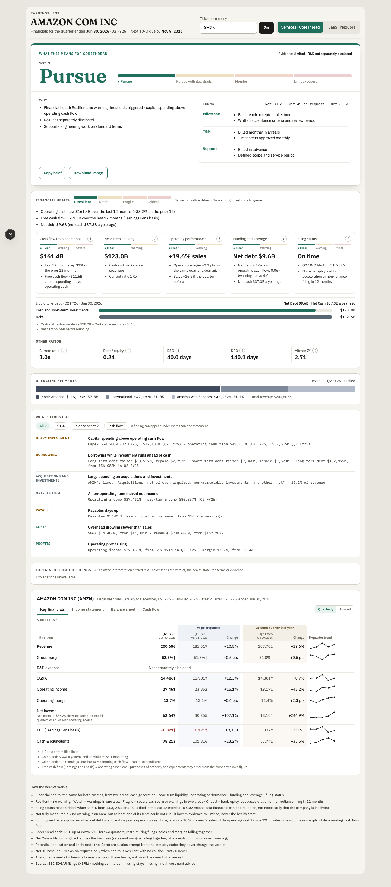
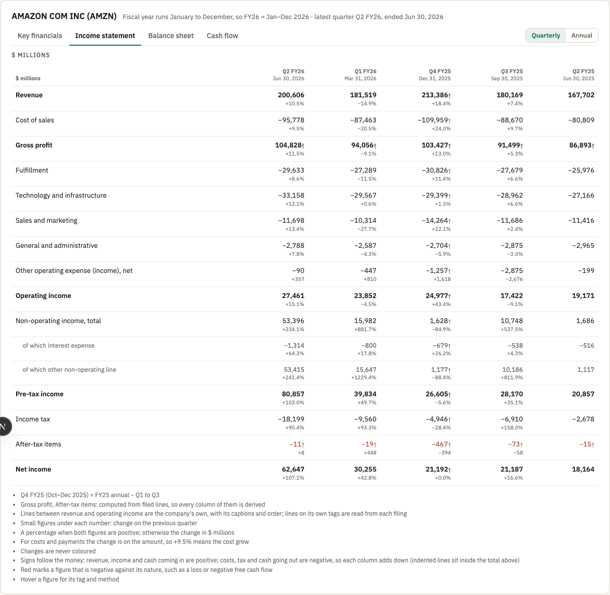
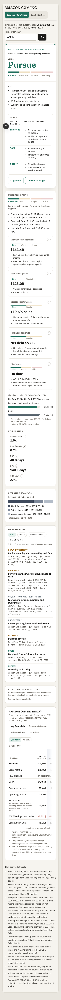

# Earnings Lens

**Live: https://earnings-lens-sigma.vercel.app**

A ticker in, a counterparty verdict and contract terms out.

Type any US-listed ticker (or a company name). The app pulls that company's
filings from SEC EDGAR, runs a fixed, locked set of rules over the filed
figures (`Earnings_Lens_Verdict_Rules_S5.md`), and answers one question per
seller: **is it financially reasonable to do business with this company on
these terms?** It shows one shared financial-health read, then a verdict, the
three reasons behind it, the payment terms and the contract protections that
follow, how complete the evidence is, and the handful of things that stand
out in the figures. Below sit the company's own statements -- the income
statement as it presents it, the balance sheet and the cash flow -- for five
quarters or three fiscal years.

The same company is read for two sellers:

| | CoreThread (services) | NexCore (SaaS) |
|---|---|---|
| **Sells** | Embedded engineering and software development | Edge AI software |
| **Contract types** | Milestone, T&M, Support | Subscription, Usage, Onboarding |
| **Its own test** | Engineering spend: R&D up or down 5%+ two quarters running, restructuring filings, sales and margins falling together | Cutting back across the business: sales and margins falling together, plus a restructuring or a cash warning |

**CoreThread and NexCore are fictional companies**, standing in for two kinds
of seller. The financial health read is the same for both; what changes is
what each seller is exposed to, so the same company can be Pursue for one and
Pursue with guardrails for the other.



Amazon, read as a counterparty on its quarter ended 30 June 2026 (screenshot
taken with the Claude layer off, so "Explained from the filings" shows its
fallback line). The page opens with the verdict card:

> **WHAT THIS MEANS FOR CORETHREAD** · Evidence: Limited · R&D not separately disclosed
>
> ## Pursue
> Pursue · Pursue with guardrails · Monitor · Limit exposure
>
> **Why**
> - Financial health Resilient: no warning thresholds triggered · capital spending above operating cash flow
> - R&D not separately disclosed
> - Supports engineering work on standard terms
>
> **Terms** Net 30 ✓ · Net 45 on request · Net 60 ✕
> - Milestone: bill at each accepted milestone · written acceptance criteria and review period
> - T&M: billed monthly in arrears · timesheets approved monthly
> - Support: billed in advance · defined scope and service period

For NexCore the verdict is also Pursue, with evidence Adequate, and the second
reason is "Cutting-back warning not triggered: sales +19.6% year over year,
operating margin +2.3 points". NexCore's card adds a commercial-discovery
band from the industry code: *Potential application: Retail and logistics
operations*, with the likely route (Partner · Device builder · **Site
operator**) -- a rough guide for sales, never part of the verdict.

Every word of the card is deterministic: the engine (`lib/verdict/`) decides
the health state, each seller's condition, the verdict, the terms, the
protections and the evidence, and `lib/verdict/why.ts` words the three Why
bullets from its result in the rules' own words (rules §17.4). A missing
number is never filled in.

Below the card, in order: Financial health, Operating segments, What stands
out, Explained from the filings, the statements, and How the verdict works.
The page has no running prose: bullets, labels and table cells only.

### The statements



Below the findings, the financials panel names the company and its fiscal
year -- "Fiscal year runs January to December, so FY26 = Jan–Dec 2026", taken
from EDGAR's fiscal year end and the filer's own 10-K period ends, because a
company's FY26 or Q4 is not the calendar's. Four tabs share one Quarterly /
Annual toggle: Key financials, Income statement, Balance sheet and Cash flow.
Key financials reads "Not separately disclosed" on the R&D row when the
company files no quarterly R&D, and labels free cash flow "FCF (Earnings Lens
basis)": operating cash flow − purchases of property and equipment, which may
differ from the company's own figure.

- **The income statement is the company's own.** Every line between revenue
  and operating income is read from each filing's instance and linkbases, in
  the latest filing's order and with its captions -- including lines on the
  company's own tags, like Amazon's Fulfillment and Technology and
  infrastructure, which company facts never carries. Signs come from the
  calculation linkbase, company subtotals are left out, and the standard rows
  around the lines (revenue, gross profit, operating income, non-operating
  income with its interest and other lines, pre-tax income, tax, after-tax
  items, net income) keep standard names.
- **The balance sheet and cash flow are standard lines**, resolved from company
  facts the way Key financials is: cash through total equity; operating cash
  flow, capital expenditures and free cash flow; acquisitions (named as the
  company names the line), investment purchases and sales; every debt line
  the filer uses, net new debt, buybacks and dividends.
- **Signs follow the money.** Income and cash coming in are positive; costs,
  tax and cash going out are negative, so each column adds down. XBRL files
  payments as positive amounts; the sign is applied at display only. Red is
  kept for a figure negative against its nature -- a loss, negative free cash
  flow, a non-operating loss.
- **The change sits under each figure**, on the previous quarter or fiscal
  year: a percentage when both figures are positive, otherwise the change in
  dollars, never coloured.
- **One presentation per column.** Every row in an income statement column
  comes from the latest-filed statement that presents that period. Where a
  standard row then differs from Key financials, the cell is marked recast
  (ᶜ): a later filing presents the period differently, and the figure shown
  is the latest presentation. Its hover names both filings: "Recast in 10-K
  filed Feb 13, 2026; originally −$77M in 10-K filed Feb 14, 2025." A
  restatement filing (8-K Item 4.02) is a different thing, and a red flag.
- **The tabs never hold up the page.** They load after the verdict; the first time a
  filing is read the panel says "Reading filing 3 of 8", one filing per
  request, and each filing's extract is stored so it is read once.

### Financial health

Shared by both sellers (rules §4). Five areas, each with its own warning
tests:

| Area | Warns when |
|---|---|
| Cash flow from operations | operating cash flow negative for two 12-month periods (Severe under 12 months of cash, a warning at 12–24 months or when runway can't be measured); or free cash flow negative for two 12-month periods while operating cash flow fell or net debt rose |
| Near-term liquidity | current ratio below 0.8 while 12-month operating cash flow is negative |
| Operating performance | sales down 15% or more and operating margin down 3 points or more, on a year ago |
| Funding and leverage | net debt above 4× 12-month operating cash flow; or operating cash flow at or below 2% of sales with net debt above 10% of sales; or net debt up by more than 10% of the size of operating cash flow while it falls |
| Filing status | a required 10-Q or 10-K past its deadline, counted in business days with 12b-25 extensions |

No warnings is **Resilient**; warnings in one area **Watch**; severe burn or
warnings in two areas **Fragile**; an 8-K Item 1.03, 2.04 or 4.02 in the last
12 months **Critical**. Every test is true, false or not measurable: a clearly
false condition wins over missing data, and a test that can't run never
counts as passed. A card with no warning but a test that couldn't run shows
a grey "Not fully measurable" tag with no step selected, and its ⓘ names each
test and the input it lacked.

Under the state bar, the summary bullets (rules §17.5): the Critical filing
first when there is one, then each warning that fired, then operating cash
flow over 12 months against the prior 12, free cash flow (Earnings Lens basis)
and net debt now and a year ago. For Amazon: *Operating cash flow $161.4B over
the last 12 months (+33.2% on the prior 12) · Free cash flow −$11.6B over the
last 12 months (Earnings Lens basis) · Net debt $9.6B (net cash $37.3B a year
ago)*.

Each card's ⓘ says, in plain words, what each measure is, this quarter's
values, and when it warns, with every figure read from the same computed
result the verdict used; it is non-modal and closes on any click outside it.
Net debt and net cash are always worded from both balances, so a company
with net cash on both dates reads "net cash down $2.2B", never "net debt
up". A missing value reads "—" with "Not available".

Beneath the cards, **liquidity vs debt** for the latest quarter: liquidity
(cash plus short-term marketable securities), debt, and net debt now and a
year ago, on the same scope the verdict used (rules §11: restricted cash,
finance arms, missing debt lines), with the net figure "before rounding" and
the company's own captions when the balance sheet gives the same totals.

**Other ratios** -- current ratio, debt / equity, DSO, DPO and Altman Z'' --
are shown with their formula and meaning in an ⓘ and are never scored; the
current ratio's ⓘ says it is used only in the near-term liquidity check.

**Operating segments** have their own section: one bar split by share of
revenue, the key below it and total revenue. The section shows only when the
filed segment amounts sum to total revenue within $1M; otherwise it is
hidden. They never feed the verdict.

## How it works

```
ticker → SEC EDGAR → data repairs → S5 engine → health, verdict, why, terms, evidence
                                  └→ What stands out → Claude explains the flagged items, below it
```

1. **EDGAR.** XBRL company facts supply the figures; the submissions feed
   supplies the filing list, 8-K item numbers, the filer category, the SIC
   code and the fiscal year end. Segment revenue, the income statement's own
   lines and the balance sheets behind net debt come from each filing's XBRL
   instance and linkbases, found through the filing index.
2. **Inputs, as of a date.** `lib/verdict/inputs.ts` builds the engine's
   inputs from that data as of the assessment date (today for the page),
   using nothing filed after it, with the data-integrity rules applied
   (rules §11): quarterly cash flow rebuilt from the newest filing when
   company facts lag, R&D tag precedence, restricted cash, finance arms,
   missing debt never read as zero, the filing calendar and business-day
   deadlines.
3. **The engine.** `lib/verdict/` is pure: flags, areas and the health state
   (§4), each seller's condition (§5), the verdict matrix (§6), payment terms
   and protections (§7), evidence (§8), the potential application and likely
   route (§9), filing status (§14 D2). Nothing here is a model output; given
   the same filings and the same date it returns the same answer.
4. **Verdict card.** Four verdicts, strictest first: Limit exposure, Monitor,
   Pursue with guardrails, Pursue. Net 30 is the baseline; Net 45 is
   available on request only for Pursue; Net 60 never. The protections are
   additive to normal billing, cell for cell from rules §7.2; NexCore's
   Monitor for a Fragile company states its condition (collected before
   activation, prepaid usage, paid onboarding). Evidence reads Exception,
   Limited or Adequate, with its reasons.
5. **What stands out.** Rule-based findings about how the figures relate and
   move: the filing-status item (overdue, filed within an extension,
   extension open, filed late), red flags, cash burn with its runway or heavy
   investment with none, borrowing, acquisitions and investments, returns, a
   one-off item, spending cuts, payables, overhead against sales, operating
   profit or loss turning, gross margin moving. Each appears only when its
   threshold fires, as a tag, a headline and the figures behind it. They
   inform and never score.
6. **Claude.** One job the rules cannot do: say *why*, from the filed text,
   for the items the rules flagged, in its own block directly below What
   stands out, each answer with its citation (form and section, e.g. "10-Q,
   MD&A").

### What Claude does, and what it is not allowed to do

Claude is asked a narrow question per flagged item and is given only filed
text to answer it from: the results 8-K with all of its exhibits (press
release, and CFO commentary or prepared remarks when a company files them),
the latest 10-Q or 10-K management discussion and notes, a Form 12b-25
late-filing notice, and any 8-K behind a flag. Each restructuring filing
(8-K Item 2.05) in the window is its own question, read from that 8-K and
cached under it, and each filing's answer is its own line with its own
citation.

Every answer comes back with the verbatim passages it relied on, and the app
checks them before anything is shown:

- each quoted passage must appear in the cited document, whitespace-normalised;
- every figure in a sentence must appear in one of those quoted passages, in
  exactly that form — so converting "7,772" into "$7.8 billion" fails the
  check;
- no sentence may restate a verdict, a payment term or a computed metric.

A sentence that fails any of these is dropped, not corrected. Because the
answer closes a finding the reader has just read, Claude is also shown that
finding's sentence and figures and told to leave them out: the answer starts
with the cause, never restates the gap or any figure already shown, and is
one sentence, two at most. If the filing gives no reason, or nothing survives
the check, the line reads "Not explained in the filing." **Claude never
computes a number and never decides anything.** The verdict, the health
state, the terms, the evidence and every figure on the page come from the
rules; the block is labelled as AI-assisted interpretation of filed text.

Answers are cached per filing and trigger, under a version number that is
bumped whenever the prompt changes, so every stored answer is regenerated
under the current instructions.

The page is complete without Claude. With the layer disabled, the API key
absent, the daily cap reached, or the call failing, the block reads
"Explanations unavailable" and everything else renders exactly as before.

## Design principles

- **A missing value stays missing.** A figure that isn't filed is shown as
  missing — never zero, never estimated; the page shows "—" with "Not
  available". Anything that depends on it is
  missing too (free cash flow without capex).
- **One tag per row.** Each line item uses one XBRL tag across all five
  quarters, chosen by a declared priority order. A cell may come from a second
  tag only once the two are shown to agree within $1M in the most recent
  period both report, with at least one of the two values non-zero, and it is
  marked as spliced when it does; the same proof lets a quarter be one tag's
  year-to-date figure less the other's prior one. Every cell carries its own
  tag, method and derived flag.
  - **Joins.** An income statement line whose element changes between filings
    is one line only when both elements report the same value (within $1M) in
    the most recent period they share, across every fact in the filings, not
    only the statement's.
  - **Two zeros never prove anything.** A splice, a join, a formula switch or
    a debt total needs a non-zero value to rest on.
  - **The latest presentation wins.** When a company restates or reclassifies
    a period, every cell for it comes from the latest filing that presents it,
    so a moved cost is never counted twice.
  - **A derived payment can't be negative.** A payment or proceeds quarter
    derived by subtraction that comes out negative means the filings don't
    reconcile; it shows as not available, and so does everything computed
    from it.
- **Declared values are in one place.** Every threshold the verdict uses is
  in `lib/verdict/rulesConfig.ts`, stated in the locked rules document, and
  read from there by both the calculation and the explanations -- every ⓘ
  and "How the verdict works" -- so the page can never disagree with the
  rule that produced it.
- **Quotes are verified, not trusted.** See above. The check runs on every
  sentence, every time, and the test suite includes a deliberately altered
  quote to prove it is dropped.
- **A percentage only when both figures are positive.** Otherwise the change
  is shown in dollars.
- **No judgement words, no prose.** Every line is a bullet, a label or a
  table cell stating a fact about the filings, never an inference about
  demand, intent or what they might buy. A favourable verdict means
  financially reasonable on these terms, not proof they need what the
  seller sells.



## Data sources and limits

Everything on the page comes from SEC EDGAR. Nothing comes from a news feed, a
price feed or a data vendor.

- **US filers only.** The app reads US GAAP XBRL from EDGAR; a foreign private
  issuer filing a 20-F is out of scope.
- **No earnings-call transcripts.** Transcripts are not filed with the SEC and
  are usually licensed by a third party, whose terms generally forbid
  reproducing quotes — and inconsistent vendor text would defeat the verbatim
  quote check. When a company *files* its prepared remarks or call script as an
  exhibit, that is filed text and is read like any other exhibit.
- **Going concern is not checked.** Filers do not tag it: a company with
  going-concern language in its 10-K had no going-concern tag anywhere in its
  XBRL instance — the paragraph is untagged prose. Scanning prose is out of
  scope, and nothing on the page presents going concern as checked.
- **Company-extension XBRL tags are read on the income statement and in the
  liquidity vs debt strip only.** The income statement's lines come from each
  filing, own tags included; the strip reads a company's own balance-sheet
  line only when its caption plainly says what it is. The Balance sheet tab,
  the cash flow and Key financials use standard tags only, because company
  facts exposes nothing else: a filer that moves a line to its own tag there
  shows that cell as not available ("filed under the company's own tag") rather
  than wrong.
- **No stock prices.** The Altman Z'' variant used here is the book-equity one,
  which needs no market capitalisation.
- **Filing windows run from the assessment date.** Red flags, restructuring
  filings and Critical filings are read over the 12 months before today, not
  before the reporting period, so the same quarter can produce a different
  result later. That is intended.
- **Not investment advice.** It is a counterparty assessment for commercial
  terms, not a view on a security.

## Running it locally

```bash
npm install
cp .env.example .env.local   # then fill in the values
npm run db:apply             # creates the tables in db/schema.sql
npm run dev
```

Three environment variables, by name (`.env.example` documents each; none of
them ever belongs in the repo):

| Variable | What it is for |
|---|---|
| `EDGAR_CONTACT_EMAIL` | SEC's fair-access policy requires a contact email in the User-Agent on every EDGAR request. |
| `DATABASE_URL` | Postgres (Neon). Holds the explanation cache, the daily call count, per-filing segment data and per-filing statement extracts. The pooled connection string is all that is needed. |
| `ANTHROPIC_API_KEY` | The explanation layer. Without it the app runs, and "Explained from the filings" shows its fallback line. |

Optional: `CLAUDE_ENABLED=false` turns the explanation layer off outright,
`CLAUDE_MODEL` overrides the model, `CLAUDE_DAILY_CAP` overrides the declared
cap of 50 calls a day.

The default model is `claude-opus-5`: the job is strict verbatim extraction
under a quote check, where a weaker model's paraphrasing shows up as dropped
sentences and an unexplained item, and per-filing caching means a company is
only ever read once, so the stronger model costs little.

## Testing

```bash
npm run check
```

That runs the type check, the linter, and:

- **The verdict engine** (`test:verdict`): the 90 regression fixtures of
  rules §12 (today's 41, 8 distress cases, 41 a year back) match exactly on
  state, fired and not-measurable flags, CoreThread direction, both verdicts
  and both evidence levels; the synthetic boundary fixtures F1–F11; the five
  filing-status cases; the as-of rule; and unit tests for logic, matrix,
  terms and evidence.
- **Display states** (`test:verdict-display`): the likely route for every
  industry-code range, Filing status Critical (1.03, 2.04, 4.02 with its
  wording), and "Not fully measurable" (Verizon's cash area, FedEx's filing
  area).
- **Why bullets and health summary** (`test:verdict-why`): every warning
  phrase, every CoreThread direction and each unknown reason, NexCore
  caution, no caution and not measurable, every verdict line for both
  sellers, Amazon's exact bullets, and the health-summary order with a
  missing fact dropped.
- **The page model** (`test:verdict-page`): on all 90 fixtures, what the page
  shows (state, verdicts, Why bullets, evidence, terms, protections, the
  NexCore condition) equals the engine's result, and every protections row,
  terms line and the Fragile condition equal the rules document's own text.
- **Input repairs** (`test:verdict-inputs`): one or more tests per
  data-integrity rule, on fixed inputs.
- The filing-deadline tests, the runway tests, the fiscal-calendar tests, the
  one-off item tests, the findings tests, the resolution tests, the quote
  verification tests including the altered-quote case, a footing test, a
  recast check, and two snapshot diffs over thirteen real companies -- every
  Key financials figure with its provenance, and every statement cell.

`scripts/verdict-page-live.ts` (report only, network, not in `check`) builds
the page's verdict for today's 41 through the page's own path and compares it
with the engine pipeline's recorded result.

The thirteen are chosen so that between them they exercise every branch worth
exercising: a derived Q4 from a just-filed 10-K (MSFT, FDX), an operating loss
whose change reads in dollars (SNAP, RIVN), a cash burn with a runway figure
(RIVN), heavy investment with none (AMZN, GOOGL), a one-off non-operating
item (NVDA, AMZN, GOOGL, UBER, ZM), a tax position that repeats from a year
earlier and so is not a one-off (RIVN), a company with no debt on its balance sheet (ZM), a
restructuring filing (FDX, SNAP) and a filing calendar that can't be projected
(FDX). The verdict's own branches are covered by the 90 regression fixtures
and synthetic cases above. Where no real filer reaches a rule, the rule gets
unit tests instead of a ticker — a first-year unusual tax item and net income
against operating income with opposite signs are in that position. A rule nothing exercises is a rule
nothing checks.

The phone layout is checked separately, because it needs a browser:
`node scripts/screenshots.mjs http://localhost:3000` opens the page at 375px in
both Chromium and WebKit, for AMZN, RIVN and NAII on both lenses, and fails if
any element inside the page body extends past its right edge — before it
takes a single screenshot, so a broken layout never reaches the README. Add
`--check-only` to run the check without the screenshots.

Other commands:

| Command | What it does |
|---|---|
| `npm run explain-report -- NVDA` | The whole Claude layer for a ticker: triggers, sources read, explanation, citation, verified passages, what was dropped, tokens spent. |
| `npm run audit-explanations` | Re-fetches every cited filing and re-verifies every stored explanation from scratch. Makes no Claude call. |
| `npm run snapshot` / `npm run statements-snapshot` | Regenerate the snapshot baselines (never without reviewing the diff). |
| `npm run test:ladder` / `npm run test:rules-snapshot` | The retired S0 ladder and rules snapshot, kept runnable but out of `check`: the S5 engine replaced the verdict they test. |

---

Built with [Claude Code](https://claude.com/claude-code) from my own written
spec (`Earnings_Lens_Build_Spec.md`) and the locked verdict rules
(`Earnings_Lens_Verdict_Rules_S5.md`). The visual target is
`Earnings_Lens_Verdict_S5_Mock.html` (mock V24); `Earnings_Lens_Statements_Mock.html`
still describes the statement tabs.
